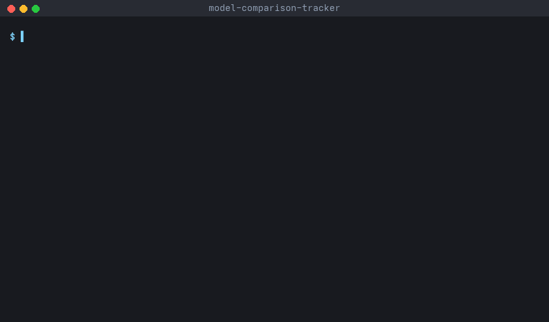
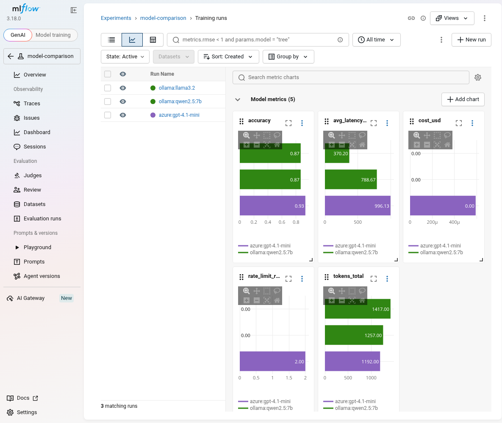
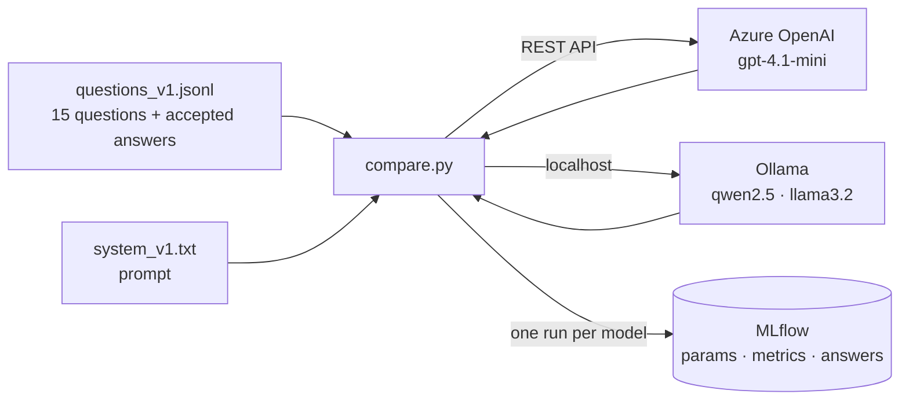
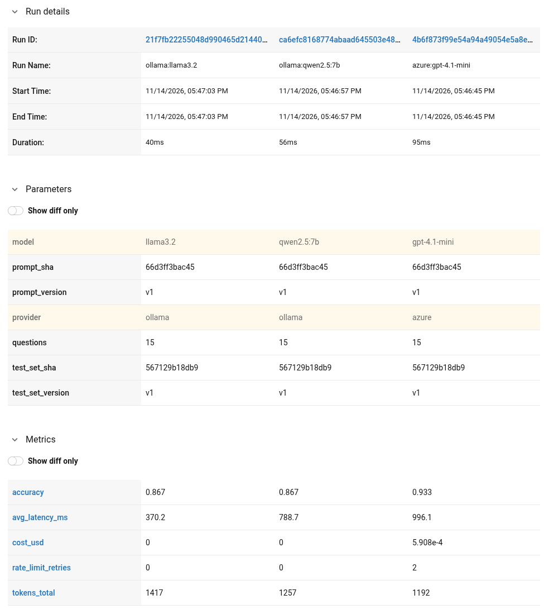

# Model Comparison Tracker on Azure

Ask the same 15 questions to a cloud model (**Azure OpenAI**) and two local models (**Ollama**),
then compare them fairly in **MLflow**: how many they got right, how fast they answered, and what it cost.



## Why I built this

I test a lot of local AI models on my laptop for coursework. My results were scattered across
notes and terminal output, and I could never be sure two tests used the same prompt and questions.
This tool fixes that: every run is saved with its scores **and** a fingerprint of the exact prompt
and question set it used, so comparisons are fair and repeatable.

## Results

One run per model, 15 questions, temperature 0.

| Model | Where it runs | Correct | Avg. time per answer | Tokens | Cost |
|---|---|---|---|---|---|
| gpt-4.1-mini | Azure OpenAI (Canada East) | **14 / 15 (93%)** | 996 ms | 1,192 | US$0.0006 |
| qwen2.5:7b | Ollama, my laptop | 13 / 15 (87%) | 789 ms | 1,257 | free |
| llama3.2 (3B) | Ollama, my laptop | 13 / 15 (87%) | **370 ms** | 1,417 | free |



**What the numbers show**

- **The cloud model was the most accurate, but not the fastest.** Its time includes the trip over
  the internet to Azure. The small local model answered in under half the time.
- **Every model failed at least one "trick" question.** The bat-and-ball puzzle (answer: 5 cents)
  beat both local models, and counting the r's in "strawberry" beat gpt-4.1-mini and llama3.2.
- **The whole Azure test cost less than one tenth of a cent** (at the list price of
  US$0.40 / US$1.60 per million input / output tokens).

## Something I learned: rate limits

My first run had two Azure errors. The cause was an **HTTP 429 "too many requests"** response,
not a model problem. I had deployed the model with a small limit (10,000 tokens per minute),
and that also caps how many requests you can send each minute.

The fix: when Azure says 429, the script waits the number of seconds Azure asks for
(`Retry-After`), then tries again. The waiting time is **left out** of the latency numbers,
so a rate limit doesn't make the model look slow. The number of retries is saved as its own
metric (`rate_limit_retries`), and it was 2 in the final run.

## How it works



1. `compare.py` sends each question, with the same system prompt, to each model and asks for a short JSON answer.
2. Each answer is marked right or wrong by checking it against a list of accepted answers (whole words only, so "0.05" does not count as "5").
3. For each model it saves one **MLflow run** with:
   - **parameters:** provider, model, prompt version, question-set version, and a short SHA-256 fingerprint of both files
   - **metrics:** accuracy, average latency, total tokens, cost in US dollars, and rate-limit retries
   - **files:** the prompt, the question set, and a table of every answer
4. MLflow's compare view puts the runs side by side.



The `prompt_sha` and `test_set_sha` values match across all three runs. That's the proof that each
model got exactly the same test. If I edit the questions, I save them as `questions_v2.jsonl` and
the new runs show a new version and fingerprint.

## How to run it

You need [uv](https://docs.astral.sh/uv/), [Ollama](https://ollama.com) with a model pulled
(for example `ollama pull llama3.2`), and an Azure subscription.

**1. Create the Azure OpenAI model** (Azure CLI, after `az login`):

```bash
az group create -n rg-model-compare -l canadaeast
az cognitiveservices account create -n <unique-name> -g rg-model-compare -l canadaeast \
  --kind OpenAI --sku S0 --custom-domain <unique-name>
az cognitiveservices account deployment create -n <unique-name> -g rg-model-compare \
  --deployment-name gpt-4.1-mini --model-name gpt-4.1-mini --model-version 2025-04-14 \
  --model-format OpenAI --sku-name GlobalStandard --sku-capacity 10
```

**2. Add your keys:** copy `.env.example` to `.env` and fill in the endpoint and key
(`az cognitiveservices account keys list -n <unique-name> -g rg-model-compare`).

**3. Run the comparison and open MLflow:**

```bash
git clone https://github.com/kchimbodza/model-comparison-tracker-on-azure.git
cd model-comparison-tracker-on-azure
uv run python compare.py azure:gpt-4.1-mini ollama:qwen2.5:7b ollama:llama3.2
uv run mlflow ui --backend-store-uri sqlite:///mlflow.db   # then open http://localhost:5000
```

**Tests** (for the answer scoring): `uv run --group dev pytest`

**Clean up Azure when you're done:** `az group delete -n rg-model-compare`

## Project layout

```
compare.py               the whole tool: ask models, score answers, log to MLflow
data/questions_v1.jsonl  15 questions, each with its accepted answers
prompts/system_v1.txt    the system prompt every model gets
tests/test_scoring.py    checks that answers are marked right or wrong correctly
docs/                    screenshots and the demo GIF
```

## Limits

- 15 questions is a small test. It's good for spotting differences, not for ranking models in general.
- One run per model. Running each a few times would show how much latency varies.
- Local speed depends on my laptop, and the cloud speed includes network time, so latency compares
  "how fast it felt to me", not raw model speed.

## Built with

Python, Azure OpenAI, Azure CLI, MLflow, Ollama, httpx, pytest

Built with help from an AI coding assistant (Claude Code). I planned, reviewed and tested every part.

## Author

**Kudzayi Chimbodza** · [GitHub @kchimbodza](https://github.com/kchimbodza)
